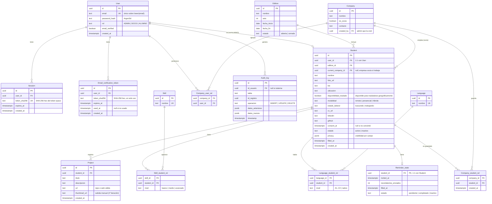

# Modelo Entidad-Relación — App Alumnos Xarxatec Activa

Diseño de la base de datos (Supabase / Postgres). Complementa a
[`especificacion.md`](./especificacion.md).

## Convenciones de nomenclatura

- **Tablas:** singular, primera letra en mayúscula, el resto en minúscula. Varias
  palabras en `snake_case` (ej. `Email_verification_token`).
- **Campos:** todo en minúscula y `snake_case`.
- **Tablas puente (N:M):** se nombran con las **dos tablas** a las que referencia
  la relación, **ordenadas alfabéticamente**, con el sufijo `_rel`
  (ej. la relación entre `Skill` y `Student` → `Skill_student_rel`).

## Estados del alumno (`Student.estado`)

- **activo:** sus datos **pueden ser consultados por las empresas**.
- **inactivo:** sus datos **siguen en el sistema** pero **no aparecen a las
  empresas**. Lo puede cambiar el **propio alumno** (se activa/desactiva) o un
  **administrador**.
- **Derecho al olvido:** el alumno puede ejercerlo; no es un estado, sino el
  **borrado** de sus datos del sistema.

## Diagrama ER

## Relaciones clave

| Relación | Tablas | Cardinalidad | Notas |
| --- | --- | --- | --- |
| Usuario — Alumno | `User` — `Student` | 1 : 0..1 | Un alumno es un usuario con rol `ALUMNO`. |
| Usuario — Sesiones | `User` — `Session` | 1 : N | Sesiones opacas en servidor; se guarda solo el SHA-256. |
| Usuario — Verificación email | `User` — `Email_verification_token` | 1 : N | Token de un solo uso para verificar el email. |
| Usuario — Empresas | `User` — `Company` vía `Company_user_rel` | N : M | Un usuario `SOCIO` puede pertenecer a una o varias empresas. |
| Edición — Alumnos | `Edition` — `Student` | 1 : N | Cada alumno pertenece a una edición. |
| Alumno — Proyectos | `Student` — `Project` | 1 : N | Proyectos vinculados al alumno. |
| Alumno — Skills | `Student` — `Skill` vía `Skill_student_rel` | N : M | Con nivel por skill. |
| Alumno — Idiomas | `Student` — `Language` vía `Language_student_rel` | N : M | Con nivel por idioma. |
| Empresa — Alumnos (empleo) | `Company` — `Student` (`current_company_id`) | 1 : N | Alumnos que trabajan en una empresa socia. |
| Empresa — Alumnos (bookmarks) | `Company` — `Student` vía `Company_student_rel` | N : M | Perfiles guardados por la empresa. |
| Alumno — Recordatorios | `Student` — `Reminder_state` | 1 : 1 | Estado del ciclo de recordatorios. |
| Usuario — Auditoría | `User` — `Audit_log` | 1 : N | Trazabilidad de mutaciones. |

## Notas de diseño

- **Identificadores:** `uuid` como PK en todas las tablas; los ids externos nunca
  reutilizan secretos.
- **Email único:** índice único sobre `lower(email)` en `User` (identificador de
  login normalizado).
- **Tablas puente** (`Skill_student_rel`, `Language_student_rel`,
  `Company_user_rel`, `Company_student_rel`): clave primaria compuesta por sus
  dos FK.
- **Privacidad:** `Student.estado` (activo/inactivo) + `Student.privacy` (JSON por
  campo) determinan qué se muestra a las empresas. El enforcement se aplica en la
  capa de aplicación (backend Hono), no en la BD.
- **Enums:** representados como `text` con `CHECK` (o tipos `enum` de Postgres)
  según convenga en la migración.
- **Borrado (derecho al olvido):** eliminar un alumno elimina en cascada sus
  proyectos, skills, idiomas, bookmarks y `Reminder_state`; el `Audit_log`
  conserva la traza sin datos sensibles.
- **Nunca** se almacena ni audita el token de sesión en claro ni el hash de la
  contraseña en `Audit_log`.
